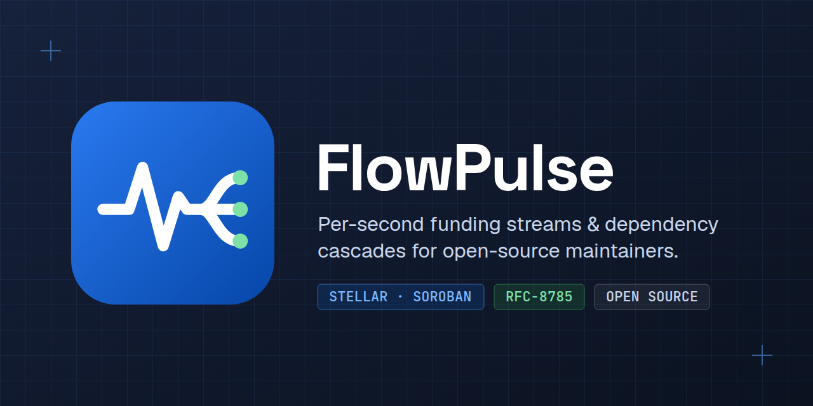

<p align="center"></p>

# FlowPulse

**Per-second funding streams and recursive dependency splits for open-source maintainers, on Stellar Soroban.**

Most open-source funding still arrives as one-off grants. FlowPulse gives sponsors a way to pay maintainers *continuously*. Each maintainer can route part of that income to the projects they depend on, and each of those projects can do the same further upstream.

| | What it does | Where |
|---|---|---|
| **Live micro-streams** | Escrow XLM and stream it to a maintainer by the second. The recipient withdraws whenever they want. The sender can top up or cancel and gets back anything not yet streamed. | [`contracts/stream_router`](contracts/stream_router) |
| **Dependency cascades** | Publish a split table generated from `Cargo.toml` / `package.json`. Funds sent to a project flow through to its upstreams, and through *their* tables, up to 3 levels deep. | [`contracts/cascade_splitter`](contracts/cascade_splitter) |
| **CI/CD bounties** | Rules that watch a repo for merged, labeled PRs. Contributors opt in with `stellar: G…` in the PR description and are paid as a bounty stream in one click. | [`frontend/src/lib/ci.ts`](frontend/src/lib/ci.ts) |
| **Audit receipts** | Every transaction yields an RFC-8785 (JCS) receipt with a SHA-256 digest, an Ed25519-signed envelope, and a Horizon ledger anchor. Anyone can verify it client-side. | [`frontend/src/lib/receipts.ts`](frontend/src/lib/receipts.ts) |

**Live demo:** https://flow-pulse.github.io/FlowPulse/ (Stellar testnet; use [Freighter](https://freighter.app) set to Testnet)

> **Status:** v0.1, **testnet only**. The contracts have not been audited, so don't point them at real funds.

## Live testnet deployment

| Contract | ID |
|---|---|
| StreamRouter | [`CA45PGMYO5CNRPCMW3THPKI26PK2CU3JU4XTJZJ3HZ4KLEFRKUQXUTWK`](https://stellar.expert/explorer/testnet/contract/CA45PGMYO5CNRPCMW3THPKI26PK2CU3JU4XTJZJ3HZ4KLEFRKUQXUTWK) |
| CascadeSplitter | [`CA4U6VUIFA33SQA5QCQYMFNEQTNN6XV43EAZ67IKXOB434V5GI5KB2SY`](https://stellar.expert/explorer/testnet/contract/CA4U6VUIFA33SQA5QCQYMFNEQTNN6XV43EAZ67IKXOB434V5GI5KB2SY) |

## Quick start

Prerequisites: Node ≥ 20 with pnpm, Rust stable with the `wasm32v1-none` target, the [Stellar CLI](https://developers.stellar.org/docs/tools/cli), and the [Freighter](https://freighter.app) wallet set to **Testnet**.

```bash
# Frontend (points at the live testnet contracts by default)
cd frontend
pnpm install
pnpm dev            # http://localhost:5173

# Contracts
cd contracts
cargo test          # unit tests (Soroban testutils)
stellar contract build

# Deploy your own copy to testnet
./scripts/deploy-testnet.sh
```

In the app, open the wallet menu and use **Friendbot** to fund your Freighter account with testnet XLM.

## How it works

> For detailed flowcharts, mathematical accrual proofs, and sequence diagrams, see [docs/architecture.md](docs/architecture.md).

### StreamRouter
Accrual is a pure function of ledger close time, so no keeper, cron, or oracle is needed:

```
streamed(t) = min(checkpoint_amount + rate_per_sec × (t − checkpoint_time), deposit)
withdrawable(t) = streamed(t) − withdrawn
```

`create_stream`, `withdraw`, `withdraw_all`, `top_up`, `cancel`, plus read methods `get_stream`, `streams_by_sender`, `streams_by_recipient`, `withdrawable`, `stream_count`. If a top-up arrives after the stream has run dry, accrual restarts from that moment, so the idle gap is never back-paid.

### CascadeSplitter
`set_splits(owner, [{recipient, bps, label}])` publishes a table. Any basis points left unallocated stay with the owner as a reserve. `distribute(from, owner, token, amount)` routes funds recursively: if a recipient has its own table, its share keeps cascading (max depth 3, which also stops cycles). Rounding dust settles with the owner at each level, so payouts always sum exactly to `amount`. `preview` returns the same routing as a free dry run.

### Audit receipts
```json
{
  "receipt": { "schema": "flowpulse.receipt/v1", "contract_id": "…", "function": "withdraw_all",
               "tx_hash": "…", "ledger": 123, "envelope_xdr": "…", "…": "…" },
  "digest":  { "alg": "SHA-256", "canonicalization": "RFC8785", "value": "…" }
}
```
To verify one: canonicalize `receipt` with any RFC-8785 implementation, SHA-256 it, and compare the result to `digest.value`. Then recompute the network-bound transaction hash from `envelope_xdr` and check its Ed25519 signature. Finally, confirm on Horizon that the transaction landed in `ledger`. The app's verifier does all three, and has a 1-bit-mutation toggle that shows tampering being caught.

## Repository layout

```
docs/                 architecture specification & Mermaid diagrams
contracts/            Soroban smart contracts (Rust)
  stream_router/      per-second streams
  cascade_splitter/   recursive split tables
frontend/             Vite + React + TypeScript + Tailwind v4
  src/lib/            soroban client, receipts (JCS), manifest parser, CI rules
  src/pages/          Live Streams · Cascades · CI/CD · Earnings
design/               original Stitch exports + design systems (reference only)
scripts/              testnet deploy script
```

The UI follows the **Architectural Drafting Standard** design system ([`design/systems/architectural_drafting_standard/DESIGN.md`](design/systems/architectural_drafting_standard/DESIGN.md)).

## Testing

```bash
cd contracts && cargo test                     # 15 contract tests
cd frontend  && pnpm test                      # unit tests (JCS vectors, Ed25519, parsers)
cd frontend  && INTEGRATION=1 pnpm test        # + live checks against testnet
```

## Roadmap

See [open issues](../../issues). Highlights:
- Headless GitHub Action that evaluates bounty rules on `pull_request.closed` webhooks
- USDC and other SAC tokens alongside XLM
- Resolving maintainer addresses automatically (`FUNDING.json`, crates.io/npm metadata)
- Weight suggestions from download counts and commit activity
- A third contract: `bounty_escrow`, with signature-authenticated webhook payouts

## Contributing

FlowPulse welcomes contributors, including through [Drips Wave](https://www.drips.network/wave). Start with [CONTRIBUTING.md](CONTRIBUTING.md) and look for issues labeled `good first issue`.

## License

[MIT](LICENSE)
