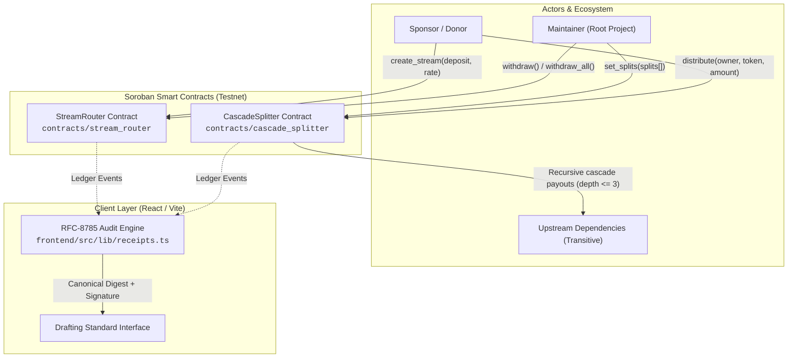
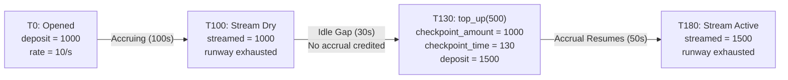
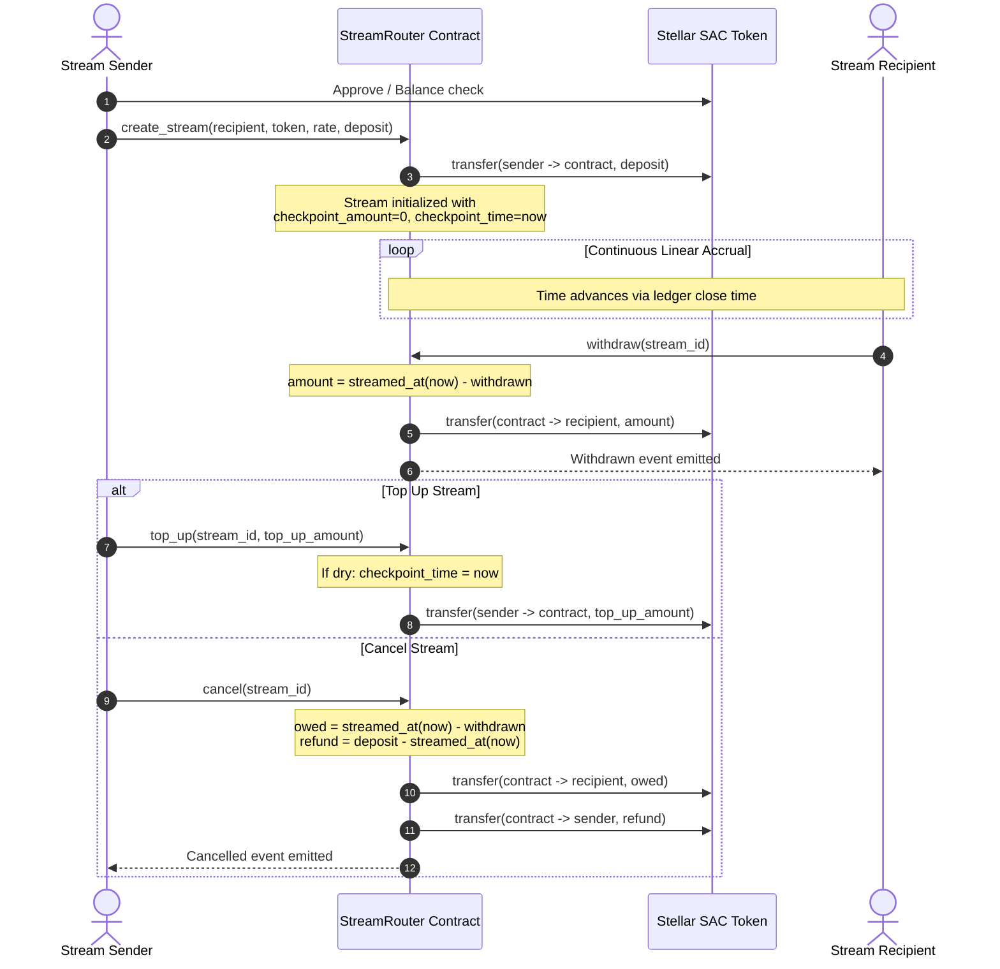
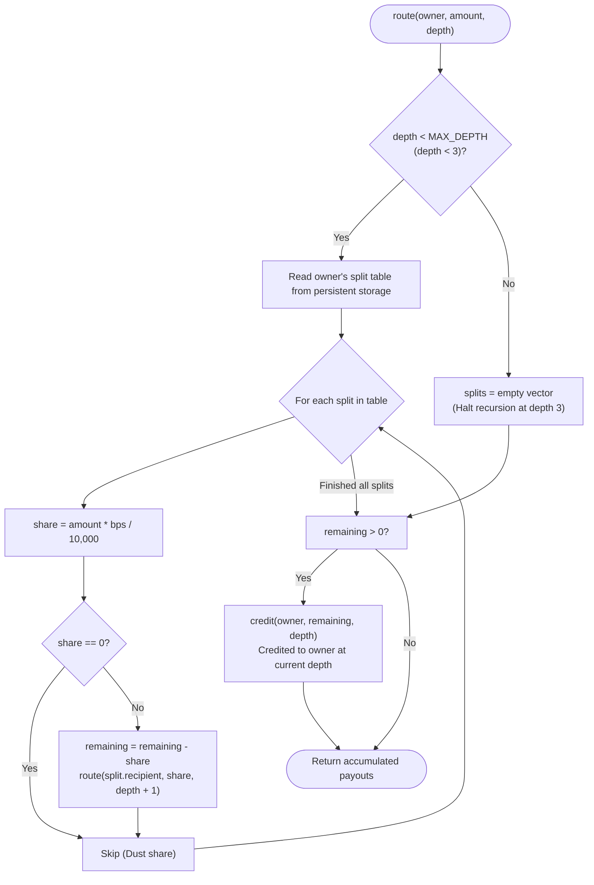
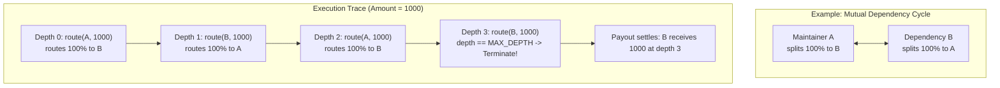
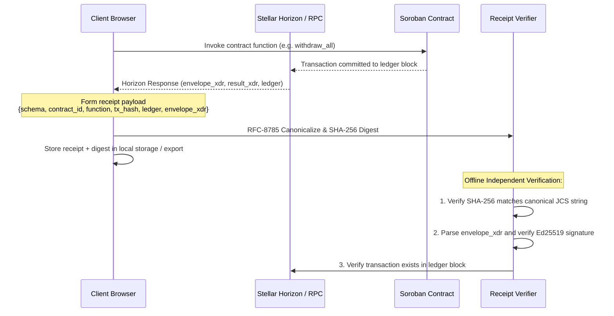

# FlowPulse Architecture Specification

This document details the core architectural mechanisms, mathematical invariants, and smart contract flows of **FlowPulse** on Stellar Soroban:
1. **StreamRouter**: Continuous per-second linear token streaming, accrual formulas, and dry-gap checkpointing.
2. **CascadeSplitter**: Recursive dependency split routing, rounding dust conservation, and cycle termination.
3. **Audit Receipts & Client Security**: Cryptographic verification under RFC-8785 (JCS) and Ed25519.

---

## 1. System Overview

FlowPulse consists of two core Soroban smart contracts written in Rust (`contracts/`), an audit receipt engine, and a web application (`frontend/`).

---

## 2. StreamRouter Architecture & Accrual Mechanics

The `StreamRouter` contract allows any account to escrow tokens and stream them to a recipient second-by-second based strictly on Stellar ledger close times (`env.ledger().timestamp()`). No keepers, cron jobs, or off-chain oracles are required.

### 2.1 Mathematical Accrual Formula

At any timestamp $t$, the cumulative amount streamed to the recipient $\text{streamed}(t)$ is governed by:

$$\text{effective\_time}(t) = \begin{cases} \text{cancelled\_at} & \text{if } \text{cancelled\_at} \ne 0 \\ t & \text{otherwise} \end{cases}$$

$$\Delta t = \max(0, \text{effective\_time}(t) - \text{checkpoint\_time})$$

$$\text{accrued}(t) = \text{checkpoint\_amount} + (\Delta t \times \text{rate\_per\_sec})$$

$$\text{streamed}(t) = \min(\text{accrued}(t), \text{deposit})$$

The withdrawable balance available to the recipient at timestamp $t$ is:

$$\text{withdrawable}(t) = \text{streamed}(t) - \text{withdrawn}$$

### 2.2 Accrual Timeline & Dry-Run Checkpointing

When a stream's deposit is exhausted, it enters a "dry" state. If the sender subsequently calls `top_up(amount)`, the recipient must **not** be credited for the idle gap while the stream had zero remaining runway.

To handle this cleanly in $O(1)$ without loop state updates:
1. `checkpoint_amount` is set to `deposit`.
2. `checkpoint_time` is updated to current ledger time `now`.
3. `deposit` is incremented by `amount`.
4. Linear accrual resumes strictly from `checkpoint_time`.

### 2.3 Stream Lifecycle Sequence

---

## 3. CascadeSplitter Architecture & Recursive Dependency Routing

The `CascadeSplitter` contract implements automated recursive revenue sharing for open-source dependency trees. Maintainers publish split tables specifying upstream dependencies in basis points (`1 bps = 0.01%`, `TOTAL_BPS = 10_000`).

### 3.1 Data Model
- `Split`: `{ recipient: Address, bps: u32, label: String }`
- `Payout`: `{ recipient: Address, amount: i128, depth: u32 }`
- Constraints per table:
  - `splits.len() <= MAX_SPLITS` (32)
  - `bps > 0` (zero weight prohibited)
  - `recipient != owner` (self-splits prohibited)
  - Recipients are strictly deduplicated
  - $\sum \text{bps} \le 10\_000$ (unallocated basis points form the owner's reserve)

### 3.2 Recursive `route` Algorithm

When funds arrive via `distribute(from, owner, token, amount)` or `preview(owner, amount)`, `CascadeSplitter` evaluates splits recursively:

### 3.3 Core Invariants & Proofs

#### Invariant 1: Conservation of Funds ($\sum \text{payouts} = \text{amount}$)
At each recursion level:
$$\text{remaining} = \text{amount} - \sum_{i} \left\lfloor \frac{\text{amount} \times \text{bps}_i}{10,000} \right\rfloor$$
Because integer truncation rounds down, $\sum \text{shares} \le \text{amount}$ and $\text{remaining} \ge 0$.
The `remaining` balance (unallocated basis points reserve + rounding truncation dust) is explicitly credited to `owner` at the current `depth`. Hence, no tokens can ever leak or be created:
$$\sum_{p \in \text{payouts}} p.\text{amount} \equiv \text{amount}$$

#### Invariant 2: Bounded Depth ($\le 3$) and Cycle Termination
The recursion parameter `depth` increments by $1$ on each child hop (`depth + 1`).
When `depth == MAX_DEPTH` ($3$), `read_splits` is bypassed and the full incoming sub-share is credited to `owner` with $0$ outgoing recursive calls.
Consequently:
1. Every payout in the resulting vector satisfies $p.\text{depth} \le 3$.
2. Mutual cycles (e.g. $A \leftrightarrow B$) or circular rings ($A \to B \to C \to A$) terminate deterministically within at most $3$ hops without stack overflow or infinite loops.

---

## 4. Cryptographic Audit Receipts

Every user transaction produces an offline-verifiable audit receipt conforming to **RFC-8785 (JSON Canonicalization Scheme)**.

---

## 5. Summary Matrix of Invariants

| Component | Invariant | Enforcement Mechanism |
|---|---|---|
| **StreamRouter** | Linear accrual per second | Pure arithmetic against `ledger().timestamp()` |
| **StreamRouter** | Dry-gap fairness | Checkpointing `checkpoint_amount` & `checkpoint_time` on top-up |
| **StreamRouter** | Payer solvency | Escrow locked on contract creation |
| **CascadeSplitter** | Strict fund conservation | Rounding dust and reserve credited to current owner |
| **CascadeSplitter** | Cycle termination | Hard cutoff at `MAX_DEPTH = 3` |
| **CascadeSplitter** | Zero weight prevention | Rejection on `bps == 0` or duplicate recipients |
| **Receipts** | Tamper detection | RFC-8785 canonical serialization + cryptographic SHA-256 digest |
