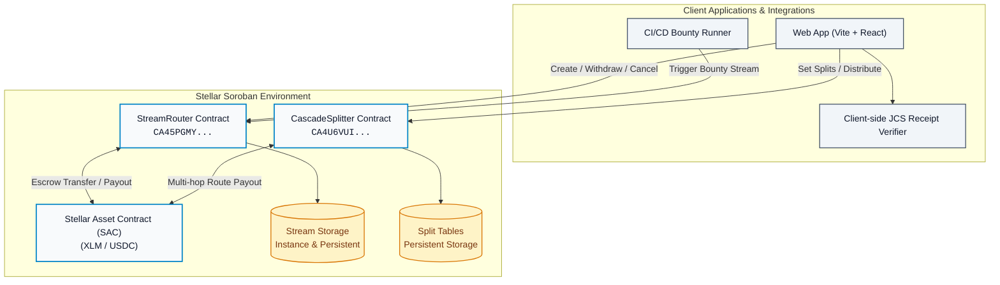
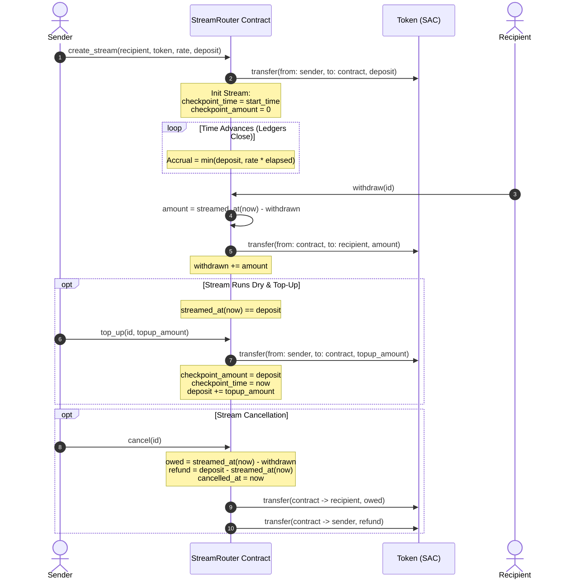
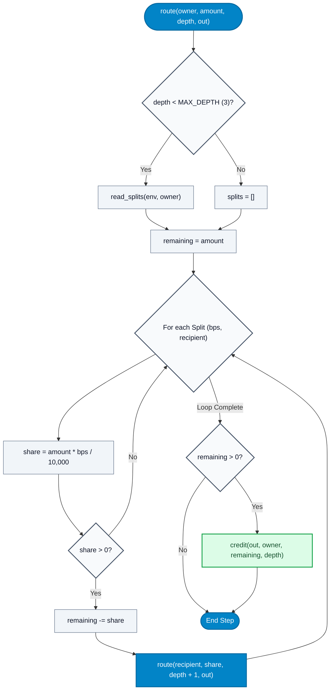
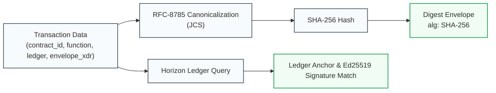

# FlowPulse Architecture Specification

FlowPulse provides continuous, per-second micro-funding streams and recursive dependency split cascades on Stellar Soroban. This document details the contract architecture, state models, accrual checkpointing formulas, and recursive distribution mechanics.

---

## 1. System Overview

FlowPulse is structured into two core Soroban smart contracts alongside an RFC-8785 cryptographic receipt verification layer:



---

## 2. StreamRouter: Accrual & Checkpointing

### 2.1 Pure Function of Ledger Timestamp
Accrual requires no off-chain keeper, cron daemon, or external oracle. The accrued amount is a pure mathematical function of the current ledger timestamp $t = \text{ledger}().\text{timestamp}()$.

#### Accrual Mathematical Formula
Given a stream $S$ with:
- $D$: Total escrowed deposit (`deposit`)
- $W$: Total withdrawn so far (`withdrawn`)
- $R$: Accrual rate in base units per second (`rate_per_sec`)
- $t_{\text{chk}}$: Checkpoint ledger timestamp (`checkpoint_time`)
- $A_{\text{chk}}$: Checkpoint accrued amount (`checkpoint_amount`)
- $t_{\text{cancel}}$: Cancellation timestamp ($0$ if active)

The effective evaluation timestamp $t_{\text{eval}}$ is:
$$t_{\text{eval}} = \begin{cases} t_{\text{cancel}}, & \text{if } t_{\text{cancel}} \neq 0 \\ t, & \text{otherwise} \end{cases}$$

The total streamed amount at timestamp $t$ is:
$$\text{streamed}(t) = \min\left(D, A_{\text{chk}} + R \times \max(0, t_{\text{eval}} - t_{\text{chk}})\right)$$

The instantly withdrawable balance for the recipient is:
$$\text{withdrawable}(t) = \text{streamed}(t) - W$$

### 2.2 Checkpointing on Top-Up (Idle Gap Protection)
When an existing stream runs dry ($\text{streamed}(t) \ge D$) and the sender later invokes `top_up(id, amount)`:
1. Accrual is checkpointed at the moment of top-up:
   $$A_{\text{chk}} \leftarrow D$$
   $$t_{\text{chk}} \leftarrow t$$
2. The deposit is increased: $D \leftarrow D + \text{amount}$.
3. Accrual resumes linearly from $t$. The idle period between stream exhaustion and top-up is never back-paid to the recipient.



---

## 3. CascadeSplitter: Recursive Revenue Splits

### 3.1 Split Table Specification
Maintainers and projects publish an upstream split table via `set_splits(owner, splits)`:
- **Total Basis Points:** $\text{TOTAL\_BPS} = 10{,}000$ ($100\%$).
- **Capacity:** At most $\text{MAX\_SPLITS} = 32$ entries per table.
- **Constraints:** Zero weights, self-splits, and duplicate recipients trigger immediate contract errors.
- **Reserve:** Any unallocated basis points ($10{,}000 - \sum \text{bps}_i$) remain with the table owner.

### 3.2 Recursive Routing Algorithm (`route`)
When `distribute(from, owner, token, amount)` or `preview(owner, amount)` is executed:
- The contract routes funds recursively up to $\text{MAX\_DEPTH} = 3$ levels.
- **Rounding Dust Conservation:** At every level, fractional rounding dust and unallocated shares stay with the current owner.
- **Cycle Termination:** Because split lookup halts when $\text{depth} \ge 3$, circular dependencies terminate predictably without infinite recursion or stack exhaustion.



### 3.3 Cascade Example
Consider a top-level library funding its transitive dependencies:

```mermaid
graph LR
    classDef rootNode fill:#0284c7,stroke:#0369a1,color:#fff,stroke-width:2px;
    classDef midNode fill:#38bdf8,stroke:#0284c7,color:#0f172a,stroke-width:1.5px;
    classDef leafNode fill:#bae6fd,stroke:#0284c7,color:#0f172a,stroke-width:1.5px;

    App["Payer: 1,000 XLM"] --> Root["Root Project<br/>Reserve: 10% (100 XLM)"]:::rootNode
    Root -->|60% (600 XLM)| DepA["Dependency A<br/>Reserve: 50% (300 XLM)"]:::midNode
    Root -->|30% (300 XLM)| DepB["Dependency B<br/>Leaf (300 XLM)"]:::leafNode
    DepA -->|50% (300 XLM)| SubDep["Sub-Dependency C<br/>Leaf (300 XLM)"]:::leafNode

    style App fill:#f1f5f9,stroke:#475569,stroke-width:1.5px;
```

Total settled:
- **Root:** 100 XLM (unallocated reserve)
- **Dependency A:** 300 XLM (unallocated reserve)
- **Dependency B:** 300 XLM (direct leaf)
- **Sub-Dependency C:** 300 XLM (cascaded depth 2)
- **Sum:** $100 + 300 + 300 + 300 = 1{,}000\text{ XLM}$ (Conservation invariant strictly held: $\sum \text{payouts} = \text{amount}$).

---

## 4. Cryptographic Audit Receipts

Every state-changing transaction in FlowPulse can generate a verifiable off-chain receipt:



1. **RFC-8785 (JSON Canonicalization Scheme):** Eliminates non-deterministic JSON serialization differences (whitespace, dictionary key order).
2. **SHA-256 Digest:** Fixed 32-byte commitment of canonical receipt fields.
3. **Horizon Ledger Anchor:** Re-verifies inclusion in the declared Stellar ledger close and validates the transaction envelope signature.
